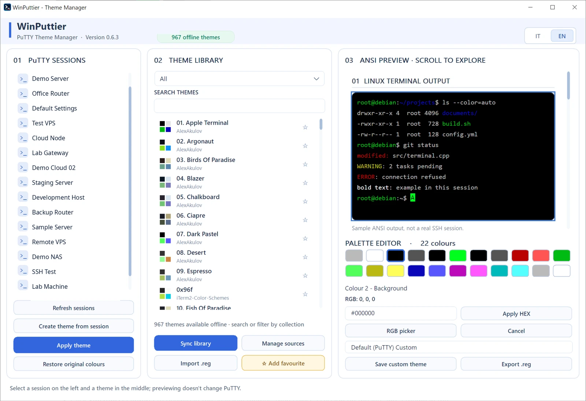

# WinPuttier

A native Windows app for previewing, editing and applying **PuTTY colour schemes**. It saves the original colours of each session before the first change so you can restore them later.

[](https://github.com/tommaso82/winputtier/actions/workflows/windows-native.yml?query=branch%3Amain)
[](LICENSE)

**Windows 10/11 · x64 · portable executable**



*WinPuttier 0.6.3 with anonymized session names.*

## Get started

To apply a theme, you need at least one saved PuTTY session.

1. Download **WinPuttier.exe** from the [latest release](https://github.com/tommaso82/winputtier/releases/latest). The executable is unsigned. The release includes `SHA256SUMS.txt` for checking the download.
2. Open WinPuttier and select a saved PuTTY session. The built-in **Default (PuTTY)** palette is available immediately; use **Sync library** (*Sincronizza libreria*) to download more themes.
3. Preview the palette and click **Apply theme** (*Applica tema*). To undo colour changes, click **Restore original colours** (*Ripristina colori originali*).
4. Reopen any running PuTTY window to see changes to its saved session.

Optional download verification: Open PowerShell in the download folder and run `Get-FileHash .\WinPuttier.exe -Algorithm SHA256`. Compare the resulting hash with the value in `SHA256SUMS.txt`.

## What it does

- **Preview and edit 22 colours.** View sample terminal output and 256 ANSI foreground/background combinations. Edit colours with HEX input or the RGB picker. PuTTY settings such as bold and system colours can affect the live terminal.
- **Change colours per session.** Applying a palette updates only the session's `Colour0`–`Colour21` registry values. The app supports standard registry-backed PuTTY sessions.
- **Keep a local theme library.** Download palettes from configurable GitHub sources, browse them offline and mark favourites. Save personal themes, export PuTTY-compatible `.reg` files or import them as palette data.
- **Use English or Italian.** WinPuttier picks a language at first launch and remembers your choice when you switch.

## Backup and local data

WinPuttier stores backups, cached palettes and personal themes under `%LOCALAPPDATA%\WinPuttier\`. The original backup is kept after restoration. **Keep the `backups` folder** if you may need to restore a session later.

See the [technical documentation](README_NATIVE.md) for the data formats, theme sources, compatibility and release process.

## Build

Build with CMake and Visual Studio 2019 or newer with the **Desktop development with C++** workload. These commands use Visual Studio 2022.

```powershell
cmake -S . -B build -G "Visual Studio 17 2022" -A x64
cmake --build build --config Release
ctest --test-dir build -C Release --output-on-failure
```

The executable is at `build\Release\WinPuttier.exe`. [GitHub Actions](.github/workflows/windows-native.yml) builds and tests the application and provides development artifacts.

## Credits

**[Tommaso (@tommaso82)](https://github.com/tommaso82)** maintains WinPuttier, with C++/Win32 and documentation assistance from **[OpenAI ChatGPT](https://chatgpt.com/)**.

WinPuttier is based on [Puttier by anonimoanemico](https://github.com/anonimoanemico/puttier), released under [CC0-1.0](LICENSE). The original Python implementation is kept for reference. See [CONTRIBUTORS.md](CONTRIBUTORS.md) and the original [CREDITS.md](CREDITS.md) for the full acknowledgments.

*Independent community project. WinPuttier has no affiliation with the PuTTY project.*
