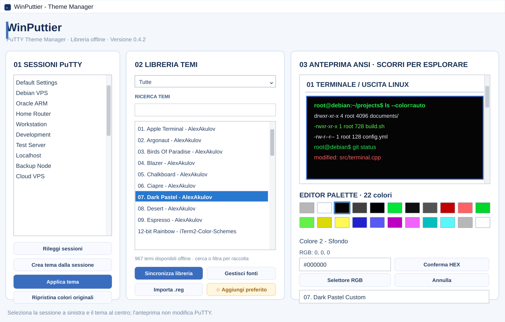

# WinPuttier

**A fast, native Windows theme manager for PuTTY.** Browse hundreds of terminal color schemes, inspect their full ANSI palette, customize any of PuTTY's 22 colors, and apply a theme to exactly the saved session you choose.

[](https://github.com/tommaso82/winputtier/actions/workflows/windows-native.yml?query=branch%3Amain)


[](LICENSE)

No Python, .NET, installer, account, or third-party runtime is required. Just one **WinPuttier.exe** for Windows x64.



*Illustrated interface overview based on a real WinPuttier 0.4.x Windows screenshot; example session names are used to protect the owner's configuration.*

## Download and start

1. Open the **[latest successful Windows build](https://github.com/tommaso82/winputtier/actions/workflows/windows-native.yml?query=branch%3Amain)**.
2. Under **Artifacts**, download **WinPuttier-Windows-x64** and extract the ZIP.
3. Run **WinPuttier.exe** on Windows 10 or 11 with PuTTY sessions already saved.

The executable is portable and requires **no installation**. GitHub Actions artifacts may require GitHub sign-in and expire; this project does not yet publish signed releases.

### Primo utilizzo (italiano)

Apri WinPuttier, premi **Sincronizza libreria** per scaricare i temi **.reg** dalle fonti configurate, scegli una **sessione PuTTY** nella colonna sinistra e un **tema** al centro. Esamina l'anteprima ANSI a destra e premi **Applica tema** soltanto quando sei soddisfatto. Il programma salva automaticamente i **colori originali** della sessione prima della prima modifica: **Ripristina colori originali** li recupera anche dopo aver provato molti temi diversi.

Scegliere un tema, modificarne l'anteprima o salvarlo come personale **non cambia PuTTY**: soltanto **Applica tema** scrive i colori nella sessione selezionata.

## What you get

| Feature | Description |
| --- | --- |
| **Precise per-session changes** | Edit only the selected session's PuTTY registry colors, `Colour0`–`Colour21`; don't touch server, login, port or other settings. |
| **Integrated ANSI preview** | Scroll through a Linux terminal example, PuTTY's six special colors, sixteen ANSI swatches, and **256 text/background combinations**. |
| **Live palette editor** | Select any of the 22 swatches, edit by **HEX** or the native **RGB** picker, and undo unsaved edits. |
| **Original-color backup** | Automatically preserve each session's first/original colors, including missing registry values; restore them later without overwriting the backup. |
| **Offline theme library** | **Sincronizza libreria** downloads only individual **.reg** files—never ZIP archives—then caches them. Subsequent syncs reuse unchanged files where revision metadata is available. |
| **Editable sources** | Add, change or remove GitHub repository, folder or single-`.reg` URLs from the **Gestisci fonti** dialog. |
| **Favorites and filtering** | Star themes, filter by source or favorites, and search by name. Favorites persist across restarts and syncs. |
| **Personal themes** | Save an edited palette or **Crea tema dalla sessione** to turn an existing session's colors into a reusable personal theme. |
| **Safe import/export** | Import a `.reg` as palette data **without executing it**; export a selected theme as a session-specific PuTTY `.reg`. |
| **HiDPI Windows UI** | Three resizable columns, native controls, and per-monitor DPI-aware rendering. |

### Built-in theme sources

WinPuttier starts with the original project's sources and the additional collection requested for this port:

- [iTerm2-Color-Schemes — PuTTY themes](https://github.com/mbadolato/iTerm2-Color-Schemes/tree/master/putty)
- [pretty-putty](https://github.com/jacek0x/pretty-putty)
- [dracula-putty](https://github.com/teeli/dracula-putty)
- [AlexAkulov/putty-color-themes](https://github.com/AlexAkulov/putty-color-themes)

Availability and number of themes depend on these independently maintained projects. WinPuttier doesn't bundle their collections with the EXE; themes are downloaded on demand through **Sincronizza libreria**. The original PuTTY default palette is built in and works without Internet.

## Buttons at a glance

| Area | Action | Result |
| --- | --- | --- |
| Sessions | **Rileggi sessioni** | Refresh saved sessions from the registry. |
| Sessions | **Crea tema dalla sessione** | Save the chosen session's current palette as a personal theme. |
| Sessions | **Applica tema** | Confirm and write the current preview palette to the chosen session, preserving the original backup. |
| Sessions | **Ripristina colori originali** | Restore the original palette of that session, not merely the previously applied theme. |
| Library | **Sincronizza libreria** | Update the catalog and cache the sources' `.reg` files for offline use. |
| Library | **Gestisci fonti** | Edit the list of GitHub theme sources. |
| Library | **Importa .reg** | Add a local PuTTY palette to personal themes without merging it into the registry. |
| Library | **☆ Aggiungi preferito** | Add/remove the selected theme from the saved favorites list. |
| Editor | **Conferma HEX** / **Selettore RGB** | Change the chosen color in the preview only. |
| Editor | **Annulla** | Discard unsaved palette edits. |
| Editor | **Salva personale** | Save the current palette to the personal library. |
| Editor | **Esporta .reg** | Produce a PuTTY-compatible registry file targeting the selected session. |

**Important:** PuTTY settings such as bold-as-color, ANSI colors and system colors can affect what a real terminal displays. WinPuttier reads those settings to guide its preview, but does not alter them. Existing open PuTTY windows may need to be reopened to pick up changed saved-session colors.

## Where your data lives

All downloaded files, personal palettes, preferences and original backups stay under:

`%LOCALAPPDATA%\WinPuttier\\`

| Path | Purpose |
| --- | --- |
| `themes\\` | Personal and imported `.reg` palettes |
| `cache\\` | Downloaded PuTTY `.reg` palettes |
| `backups\\` | Original per-session color snapshots (`.wpb`) |
| `favorites.tsv` | Theme favorites |
| `sources.ini` | Editable GitHub sources |
| `catalog.tsv` / `sync-index.tsv` | Theme catalog and incremental sync metadata |

Backups are **per session**, created before the first color change by WinPuttier, and **never overwritten** by applying later themes. Do not delete the `backups` directory if you want to retain the ability to restore original colors.

## Build from source

Requires Windows, CMake and Visual Studio 2019 or newer with the **Desktop development with C++** workload.

```powershell
cmake -S . -B build -G "Visual Studio 17 2022" -A x64
cmake --build build --config Release
ctest --test-dir build -C Release --output-on-failure
```

The standalone binary is at `build\Release\WinPuttier.exe`. The project uses C++17, native Win32, WinHTTP and the MSVC static runtime. [GitHub Actions](.github/workflows/windows-native.yml) builds and tests it on Windows automatically. A Visual Studio 2019 generator can also be used.

### Limitations

- Windows only; supports PuTTY sessions saved in the normal **Windows registry**, not every portable PuTTY variant.
- This program edits *colors*, not fonts, terminal behavior, SSH credentials or connection settings.
- Theme sync requires network access to configured GitHub sources; saved palettes remain usable offline.
- Builds are currently **unsigned**; please download only from this repository's own Actions runs.

## Contributors & acknowledgments

**The people and projects behind WinPuttier deserve visible credit:**

- **[Tommaso (@tommaso82)](https://github.com/tommaso82)** — creator, maintainer, design and testing.
- **OpenAI ChatGPT (GPT-6)** — AI-assisted C++/Win32 development, interface iteration and documentation. AI assistant, not a human/GitHub account.
- **[anonimoanemico](https://github.com/anonimoanemico)** — author of the original **[Puttier](https://github.com/anonimoanemico/puttier)** Python project (CC0 1.0).
- **[mbadolato](https://github.com/mbadolato)** — **[iTerm2-Color-Schemes](https://github.com/mbadolato/iTerm2-Color-Schemes)**, credited by the original Puttier.
- **[jacektrocinski](https://github.com/jacektrocinski)** — **[pretty-putty](https://github.com/jacektrocinski/pretty-putty)**, credited by the original Puttier.
- **[teeli](https://github.com/teeli)** — **[dracula-putty](https://github.com/teeli/dracula-putty)**, credited by the original Puttier.
- **[AlexAkulov](https://github.com/AlexAkulov)** — **[putty-color-themes](https://github.com/AlexAkulov/putty-color-themes)**, additional WinPuttier source.

**[Meet the contributors and see full acknowledgments](CONTRIBUTORS.md)** · **[Read all original theme-author credits](CREDITS.md)**

The long original [theme-credit list](CREDITS.md), original [README](docs/README-puttier-original.md), [Python source](puttier/) and [CC0-1.0 license](LICENSE) are retained. Hundreds of individual theme authors are individually acknowledged in that original credit list, which remains unchanged.

WinPuttier is independent from PuTTY itself. GitHub's automated contributors panel is based on commits and GitHub identities; ChatGPT has no such account, so it is credited accurately in the project documentation instead.

---

*WinPuttier is an independent community project and is not affiliated with or endorsed by the PuTTY project.*
